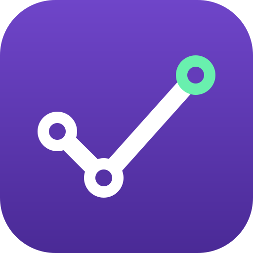

# ros2-agent-kit

`ros2-agent-kit` is a set of agent skills, hooks, and checks dedicated to ROS 2 development.
It targets Claude Code, Codex, and Gemini CLI from one source tree.
It covers three jobs: building ROS 2 applications, contributing issues and pull requests to the ROS 2 mainline, and recurring maintainer work such as launching CI on ci.ros2.org.

Its distinguishing feature is contribution compliance.
It encodes the DCO sign-off, the OSRF generative-tools policy, and the upstream PR and issue templates as machine-checkable rules, and enforces them before anything reaches a maintainer.

This is a personal project of a ROS 2 maintainer.
It is not an official ROS project.
The full design, including the roadmap, is in [design/ros2-agent-kit-design.md](design/ros2-agent-kit-design.md).

## Why this exists

- **Common, consistent skills:** one shared set of agent skills helps developers and users make ROS 2 better.
- **Maintained by people who know the core:** scattered skill packs are not well maintained, so these skills are kept by a maintainer of the ROS 2 core.
- **No reinventing the wheel:** nobody has to write the same ROS 2 skills and rules again and again.
- **AI guidelines built in:** the ROS guidelines for AI-assisted contributions are implemented in the skills and plugins.
- **More useful tools:** developers and maintainers get more tools for their everyday ROS 2 work.

The slides in [presentation/overview.md](presentation/overview.md) explain the same points with diagrams.

## What is in the box

| Part | Content |
| --- | --- |
| Policy | Profiles in `policy/`, selected by the git remote: `osra-ros2` for `github.com/ros2/*`, `generic-dco` for other DCO projects, `app` for your own code |
| Gate engine | `ros2-gate`: the checks behind every hook, git hook, and CI job |
| Skills | Contribution: `contribute-preflight`, `commit`, `pr-prepare`, `issue-report`, `review-respond`, `backport`, `api-abi-stability`; code rules: `cpp-style`, `python-style`, `cmake-style`, `docs-style`, `lint-and-test`; application development: `workspace-and-packages`, `nodes-and-components`, `executors-and-qos`, `launch-and-interfaces`, `testing`, `introspection`; maintainer: `ci-trigger`, `ci-status`, `buildfarm-triage`, `maintainer-triage`, `rosdistro-release`, `contribution-report` |
| Hooks | Claude Code and Codex through `hooks/hooks.json`; Gemini CLI through the generated `gemini` branch |
| Tier C | `ci/action.yml` for GitHub Actions and `.pre-commit-hooks.yaml` for pre-commit, so the rules hold for contributors on any tool |
| Subagents | `contribution-auditor` audits a branch before the PR packet; `style-reviewer` reviews a diff against the style skills; both read-only |
| Tools | `tools/detect_packages.py` maps PR diffs to ROS packages; `tools/fetch_templates.py` caches an organization's templates; `tools/watch_sources.py` detects changes in the upstream policy documents |

## What the gates do

| Gate | When | Check | Result |
| --- | --- | --- | --- |
| G1 | The agent runs `git commit` | The author is the human contributor, not an agent identity; the DCO sign-off is present; hooks are not bypassed | Block |
| G2 | The agent runs `git push` | Every commit since the merge base passes G1, and the evidence ledger holds a successful build and test for the current tree | Block |
| G3 | The agent runs `gh pr create`, `gh issue create`, any `gh` comment, review, edit, or merge command, or a mutating `gh api` call | Creating or changing a pull request or an issue runs only after you confirm the exact command; comments and reviews are not allowed for the agent | Confirm, or block for comments and reviews |
| G4 | The agent writes `PR_BODY.md` or `ISSUE_BODY.md` | Every template section is present, the generative-AI disclosure is filled in, no placeholder is left; sections the human writes may stay empty in a draft | Block |
| G5 | Session start | The active profile and ROS distribution are printed | Inform |
| G6 | The agent edits a C++, Python, CMake, XML, or documentation file | The ament linter for that file type when installed, otherwise 100 columns, tabs, one sentence per line | Advise |
| G7 | The agent ends its turn | A claim such as "all tests pass" without a matching successful entry in the evidence ledger | Advise |

G3 follows the OSRF policy: you write the description and the replies, and you stay responsible for what is submitted.
It confirms through the harness's own permission prompt, which today only Claude Code can show from a hook.
In Codex, Gemini CLI, and Claude Code's bypass-permissions mode it blocks the command and gives it to you to run, so nothing is submitted unconfirmed.
The table shows the `osra-ros2` profile; under `app` and `generic-dco` the agent may post.

## Evidence ledger

An agent may only report a build, lint, or test result that it ran on the current tree.
`ros2-gate run -- <command>` runs the command and records it with the exit code, the commit, and a hash of the working tree in `.ros2-agent-kit/evidence.jsonl`, which the kit excludes from git.
`ros2-gate evidence` prints the entries that match the current tree; the PR packet quotes them and G2 requires them.

```bash
python3 gate/ros2-gate run -- colcon build --packages-select rclcpp
python3 gate/ros2-gate run -- colcon test --packages-select rclcpp
python3 gate/ros2-gate evidence
```

`ROS2_GATE_PROFILE=osra-ros2` forces a profile.

## Install

Claude Code:

```text
/plugin marketplace add fujitatomoya/ros2-agent-kit
/plugin install ros2@ros2-agent-kit
```

Or in one step on Claude Code 2.1.275 or later:

```text
/plugin install ros2 --marketplace fujitatomoya/ros2-agent-kit
```

Codex:

```bash
codex plugin marketplace add fujitatomoya/ros2-agent-kit
```

Then install `ros2` from the marketplace in the Codex app and review its hooks when asked; Codex runs bundled hooks only after you trust them.

Gemini CLI, from the generated branch:

```bash
gemini extensions install https://github.com/fujitatomoya/ros2-agent-kit --ref gemini
```

Requirements: `git`, and `python3` 3.10 or newer, which every supported ROS 2 distribution provides.
The gate engine has no third-party dependencies and makes no network calls.
Run `python3 gate/ros2-gate doctor` to see what is set up and what is missing.

## Enforcement without an agent

For contributors on any other tool, and for CI:

```yaml
# .github/workflows/ros2-gate.yml in a target repository
- uses: fujitatomoya/ros2-agent-kit/ci@main
  with:
    profile: osra-ros2
```

```yaml
# .pre-commit-config.yaml
- repo: https://github.com/fujitatomoya/ros2-agent-kit
  rev: main
  hooks:
    - id: ros2-gate-commit-msg
    - id: ros2-gate-pre-push
```

Or without pre-commit: `python3 gate/ros2-gate install-hooks` writes `commit-msg` and `pre-push` hooks into the current repository.

## Running the gate by hand

```bash
python3 gate/ros2-gate profile                      # which rules apply here, and why
python3 gate/ros2-gate doctor                       # prerequisites and setup hints
python3 gate/ros2-gate check-commit HEAD            # sign-off, identity, Assisted-by format
python3 gate/ros2-gate check-range                  # every commit since the merge base with rolling
python3 gate/ros2-gate check-pr-body PR_BODY.md --issue 1234
python3 gate/ros2-gate check-issue-body ISSUE_BODY.md --template bug_report
python3 gate/ros2-gate guard -- gh pr create        # allow, block, or ask you to confirm, with the reason
python3 gate/ros2-gate lint-file src/node.cpp       # fast advisory style check
echo "all tests pass" | python3 gate/ros2-gate check-claims   # claims without evidence
```

Exit codes: 0 pass, 1 fail, 2 usage or runtime error, and 3 from `guard` when a command needs your confirmation.

Templates are read from the target repository, never vendored.
When a repository relies on its organization's default templates, cache them once:

```bash
python3 tools/fetch_templates.py ros2
```

## CI on ci.ros2.org

The `ci-trigger` skill composes `ros-ci-for-pr` commands with the packages detected from the PR diffs, shows the command, and runs it only after you confirm.
It needs `ros-ci-for-pr` installed, a classic GitHub token in `GITHUB_ACCESS_TOKEN` with the `public_repo`, `gist`, and `read:org` scopes, and build access to ci.ros2.org.
The kit never stores or prints the token.
The detector also works on its own:

```bash
ros-ci-for-pr --packages $(python3 tools/detect_packages.py ros2/demos#806)
python3 tools/detect_packages.py --local     # packages touched by the current branch, no network
```

## Skill evaluations

`evals/` holds `claude plugin eval` cases: one prompt per skill that must trigger it, and an unrelated prompt that must not.
They cost model calls, so they run before a release, not in CI; see [evals/README.md](evals/README.md).

## Distribution matrix

`.github/workflows/distro-matrix.yml` runs the gate and tool tests and `evals/app_smoke.sh` inside the `ros:<distro>-ros-base` image of every active distribution listed in `policy/distributions.json`, on every change and weekly.
The smoke check creates packages the way the `workspace-and-packages` skill says, builds them, and runs `colcon test` with the linters, so a skill instruction that stops holding on a distribution fails the build.
Distributions whose image is not yet verified run as experimental and do not fail the workflow.

## Keeping pace with upstream

`policy/sources.json` lists every upstream document a rule depends on, with a content hash and a last-verified date.
A weekly workflow re-fetches them and opens an issue when one changed, so a policy change is reflected within 14 days.
After re-verifying, `python3 tools/watch_sources.py --update` stores the new hashes.

## Development

```bash
cd gate && python3 -m unittest discover -s tests -t . -v
cd tools && python3 -m unittest discover -s tests -t . -v
```

The repository applies its own rules: DCO sign-off on every commit, the ROS PR template with the generative-AI field, Apache-2.0 headers, and `ros2-gate check-range` in CI.
See [CONTRIBUTING.md](CONTRIBUTING.md).

## License

Apache-2.0, see [LICENSE](LICENSE).
