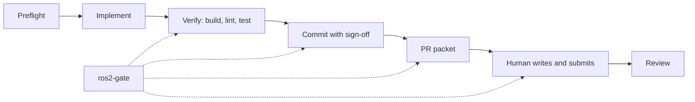

# ros2-agent-kit: design document

| | |
| --- | --- |
| Status | Draft v0.8, M1 implemented |
| Date | 2026-11-23 |
| Owner | Tomoya Fujita |
| Repository | <https://github.com/fujitatomoya/ros2-agent-kit> |
| Plugin name | `ros2`, so commands read `/ros2:pr-prepare` |
| License | Apache-2.0 |
| AI disclosure | Assisted-by: Claude:claude-fable-5-2 |

This document follows the ROS documentation style: one sentence per line, ATX headings, and a syntax on every code block.

## 1. Summary

`ros2-agent-kit` is a set of agent skills, hooks, and checks dedicated to ROS 2 development.
It targets Claude Code, Codex, and Gemini CLI from one source tree.
It covers three jobs: building ROS 2 applications, contributing issues and pull requests to the ROS 2 mainline, and recurring maintainer work such as launching CI on ci.ros2.org.

Its distinguishing feature is contribution compliance.
It encodes the ROS code style, the DCO sign-off, the OSRF generative-tools policy, and the upstream issue and PR templates as machine-checkable rules, and it enforces them before anything reaches a maintainer.

It is a personal project of a ROS 2 maintainer, and every rule in it cites the upstream document it comes from.

## 2. Motivation

### 2.1 The problem upstream

The ROS PMC published guidelines for AI-assisted contributions on 2026-06-29 because of an uptick in LLM-authored pull requests.
The OSRF amended its generative-tools policy on 2026-11-05.
Maintainers now close unverified LLM output without review, and repeat offenders can be blocked.

Most contributors who trip these rules are not acting in bad faith.
Their agent simply does not know the rules, and general-purpose kits teach the opposite behavior.
For example, a typical `/pr` command drafts the PR description, which the OSRF policy forbids.

### 2.2 The problem with existing ROS 2 skill packs

Several public packs exist, and they are useful for writing ROS 2 code.

| Project | Form | Gap |
| --- | --- | --- |
| `dbwls99706/ros2-engineering-skills` | Claude plugin with hooks, knowledge-only elsewhere | No contribution compliance |
| `harunkurtdev/ros2-claude-code-template` | Copy-in `.claude/` template | Claude only, no hooks, no compliance |
| `Leehyunbin0131/claude-ros2-skills` | Claude plugin, Jazzy only | No contribution compliance |
| `arpitg1304/robotics-agent-skills` | Loose `SKILL.md` files | No enforcement |

As far as we can tell, none of them is owned by maintainers of the code they describe.
That creates two risks: the content drifts from mainline, and the project stops when its author moves on.

### 2.3 Why a ROS-specific kit and not ECC

ECC is a good general harness, and this kit should compose with it, not replace it.
ROS 2 needs things a general kit cannot know: `ament_lint` as the style oracle, rolling-first branching, ABI rules, the upstream templates, and a policy that restricts what an agent may write.

### 2.4 Maintainer toil

Maintainers have their own repetitive work that no existing pack covers.
One example is launching CI on ci.ros2.org for a pull request.
The official `ros-ci-for-pr` tool needs an explicit package list, and for a PR in a repository with many packages, such as `ros2/demos#806`, that list is assembled by reading the diff and mapping each file to its `package.xml` by hand.
The invocations also vary in target distribution, bundled PRs, build and test sets, and extra arguments, so a fixed form such as a `workflow_dispatch` button does not fit.
An agent can derive the package list deterministically, compose the command, and ask the maintainer to confirm it.
The kit therefore includes maintainer workflows as a third job, built on the same principles as the contribution workflow.

## 3. Goals and non-goals

### 3.1 Goals

1. An agent using the kit produces contributions that pass the ROS rules on the first submission.
2. The rules are enforced by checks, not only described in prose.
3. One source tree serves Claude Code, Codex, and Gemini CLI.
4. Enforcement still works for contributors on any other tool, through git hooks and CI.
5. Every rule is traceable to an upstream source and is re-verified when that source changes.
6. Every skill is owned by the project owner, who maintains the related upstream code.
   Other owners may be added in a later phase.
7. Recurring maintainer workflows, starting with CI on ci.ros2.org, run through natural language using the official tool and the maintainer's own credentials.

### 3.2 Non-goals

1. Controlling robots at runtime through an agent.
2. Covering Nav2, MoveIt 2, ros2_control, or Autoware in the first version.
   Those belong to their own maintainers, see section 11.3.
3. Submitting pull requests, issues, or review replies on the human's behalf.
4. Duplicating general skills such as TDD or generic code review.
5. Replacing human review or the DCO attestation.
6. Forking or replacing upstream maintainer tools such as `ros-ci-for-pr`; improvements go upstream.
7. Storing or managing credentials; tokens and ci.ros2.org access stay in the user's environment.
8. Triggering CI from GitHub comments, which needs workflows in the upstream repositories.

## 4. Design principles

**P1. Upstream is the source of truth.**
The kit reads the target repository's own `AGENTS.md`, `CONTRIBUTING.md`, and templates at run time.
Precedence is: target repository files, then the organization default `AGENTS.md` and policy profile, then kit defaults.

**P2. Linters are the oracle, skills are hints.**
Skills hold only the rules an agent gets wrong, plus a pointer to the guide.
`ament_lint` and the tests decide what is correct.

**P3. Checks over prose.**
If a rule can be checked by a program, it is a gate.
Skills explain how to pass the gate.

**P4. The human owns the words.**
The agent may write code, tests, and documentation.
The agent does not write PR descriptions, issue text, or discussion replies for upstream.

**P5. No claim without evidence.**
The agent may only report a build, lint, or test result that was actually run on the current tree.

**P6. Small and owned.**
The core stays small enough for one maintainer to keep current with mainline.
A skill that cannot be kept current is removed.

**P7. One core, thin adapters.**
All logic lives in harness-neutral files.
Per-harness files only translate formats.

**P8. Wrap, do not fork.**
Maintainer skills orchestrate the official tool as installed.
They read its `--help` at run time instead of hardcoding flags, and improvements are sent upstream so the kit stays correct without lock-step releases.

## 5. Users and use cases

| Persona | Typical task | What the kit does |
| --- | --- | --- |
| Application developer | Create a package, node, launch file, tests | Scaffolds to ROS conventions, runs linters and tests |
| First-time contributor | Fix a bug in `rclcpp` | Preflight on the issue, style, sign-off, PR packet |
| Regular contributor | Feature plus backport | Rolling-first flow, ABI checks, backport title format, a ready-to-run CI command to hand to a maintainer |
| Maintainer | Triage, review, CI | Read-only assistance for triage; CI jobs on ci.ros2.org with detected packages and confirmation; the maintainer writes all replies |
| Any contributor on another tool | Any of the above | Git hooks and the CI action still apply |

## 6. Architecture

### 6.1 Three enforcement tiers

Skills are advisory, and agent hooks differ per harness and can be disabled.
The design therefore has three tiers that share one check engine.

| Tier | Mechanism | Harness-dependent | Can the contributor bypass it |
| --- | --- | --- | --- |
| A. Knowledge | Skills, plus `AGENTS.md` and `GEMINI.md` context | No | Yes |
| B. Agent gates | Harness hooks calling `ros2-gate` | Yes | Yes, by disabling hooks |
| C. Repository gates | `pre-commit` git hooks and a GitHub Action calling `ros2-gate` | No | Local git hooks yes, the CI action no |



### 6.2 The gate engine: `ros2-gate`

`ros2-gate` is a single command-line tool written in Python with the standard library only.
It supports Python 3.10 and newer, because Ubuntu 22.04 and Humble ship 3.10.
ROS 2 environments always have `python3`, so it needs no installation step inside the plugin: `python3 gate/ros2-gate <subcommand>`.
It makes no network calls and never modifies files unless a subcommand says so.
Helpers that need the GitHub API, such as package detection, live in `tools/` and stay out of the gate engine, see section 6.6.

| Subcommand | Purpose |
| --- | --- |
| `profile` | Detect the policy profile from the git remote and print the active rules |
| `check-commit` | Validate sign-off, author identity, and `Assisted-by` trailer format |
| `check-range` | Validate every commit between the merge base and `HEAD` |
| `check-pr-body` | Validate a PR body file against the target repository's template |
| `check-issue-body` | Validate an issue body file against the chosen issue template |
| `run -- <cmd>` | Run a build, lint, or test command and record the result in the evidence ledger |
| `evidence` | Print the evidence that matches the current tree |
| `guard` | Decide whether a shell command is allowed under the active profile |
| `doctor` | Report the prerequisites of the kit in this environment: identity, profile, templates, tools, token |
| `install-hooks` | Write `commit-msg` and `pre-push` git hooks that call the gate, for contributors without pre-commit |

Hooks, git hooks, and CI all call these same subcommands.
A rule therefore has one implementation and one set of unit tests.
Exit codes are uniform: 0 for pass or allow, 1 for fail or block, 2 for a usage or runtime error.
`run` and `evidence` arrive with the evidence ledger in M2; the other subcommands exist since M0.

### 6.3 Policy as data

Rules live in profile files, not in skill prose.
A profile is selected by the git remote of the working repository, with the `upstream` remote checked before `origin` so that a fork with the usual `upstream` remote gets the upstream profile.
Profiles are JSON, not YAML, because the gate engine is standard-library Python and Python 3.10 has no YAML or TOML parser.

```json
{
  "id": "osra-ros2",
  "applies_to": {"remotes": ["github.com/ros2/*"]},
  "sources": ["osrf-genai-policy", "ros-pmc-ai-guidelines", "ros2-developer-guide"],
  "rules": {
    "dco": {"required": true, "signoff_must_match_author": true, "forbid_agent_identity": true},
    "ai_disclosure": {
      "pull_request": "required",
      "issue": "required",
      "commit_trailer": "recommended",
      "trailer_format": "Assisted-by: {agent}:{model} [{tools}]"
    },
    "authorship": {
      "pr_description": "human",
      "issue_body": "human",
      "discussion_replies": "human",
      "agent_may_post": false
    },
    "hooks": {"allow_bypass": false},
    "branching": {"target": "rolling", "backport_title": "[{Distro}] {original title}"},
    "verification": {"build": "required", "tests": "required", "lint": "ament_lint_common"}
  }
}
```

Sources are referenced by id and described once in `policy/sources.json`, which carries the URL, the last-verified date, and the content hash for the watch job of section 11.2.
The list of agent identities that may never author or sign off a commit lives in `policy/agent-identities.json`, shared by all profiles.

Initial profiles:

| Profile | Scope | Notes |
| --- | --- | --- |
| `osra-ros2` | The `ros2` organization only | Full enforcement |
| `app` | The user's own project | Style, lint, and tests on; authorship rules off; DCO optional |
| `generic-dco` | Any DCO project without a dedicated profile | Sign-off and disclosure only |

Other OSRA organizations such as `ament`, Gazebo, and Open-RMF are left for a later phase.
Non-OSRA projects such as Autoware have their own policies and need their own profiles.

### 6.4 Evidence ledger

The proposed upstream `AGENTS.md` says an agent must never claim verification that was not run.
The ledger makes that checkable.

`ros2-gate run -- colcon test --packages-select rclcpp` records the command, exit code, timestamp, `HEAD`, and a hash of the working tree.
The ledger is a git-ignored file in the workspace.
`ros2-gate evidence` prints only entries whose tree hash matches the current tree.
The PR packet lists those entries as facts, and the agent may not state any other verification.

### 6.5 Templates are read, not vendored

The kit does not ship copies of upstream templates.
It reads `.github/PULL_REQUEST_TEMPLATE.md` and `.github/ISSUE_TEMPLATE/` from the target repository, and falls back to the organization defaults in `ros2/.github`.
Most `ros2` repositories rely on the organization defaults, and the gate has no network access, so `tools/fetch_templates.py` caches them under `$XDG_CACHE_HOME/ros2-agent-kit/templates/<org>/` and the gate reads that cache.
Issue templates in the `ros2` organization are GitHub issue forms, and the gate reads the subset of that YAML it needs with a line scanner rather than a YAML parser.
This removes one whole class of drift.

### 6.6 Network helpers in `tools/`

Some maintainer workflows need the GitHub API, for example to list the files changed by a pull request that is not checked out locally.
Those helpers live in `tools/`, are stdlib-only Python like the gate engine, and are read-only against GitHub.
They are the only code in the kit that touches the network, and every call uses the user's ambient token.
Keeping them out of `ros2-gate` preserves the guarantee that hooks and CI gates never make network calls.

The first helper is `fetch_templates.py`, which caches an organization's default PR and issue templates for section 6.5.
The second is `detect_packages.py`, described in section 8.6.
It has a local mode that reads `git diff` against the merge base and walks the working tree for `package.xml`, so contribution skills can use it without any network access.

## 7. Components

### 7.1 Skills

Skills use the open `SKILL.md` format, one directory per skill, with long material in `references/` loaded on demand.
All three harnesses discover `skills/<name>/SKILL.md` at the package root.

**Contribution to mainline**

| Skill | What it does | Milestone |
| --- | --- | --- |
| `contribute-preflight` | Identify repository and profile, confirm the issue is still valid and the approach is agreed, branch from `rolling` | M1 |
| `commit` | Meaningful commits, sign-off, `Assisted-by` trailer, separate commit for file moves | M1 |
| `pr-prepare` | Build the PR packet, see section 8.2 | M1 |
| `issue-report` | Choose the tracker, search duplicates, gather environment facts, see section 8.3 | M1 |
| `review-respond` | Explain review comments and implement code changes; never drafts replies | M2 |
| `backport` | Rolling-first rule, backport title format, API and ABI checks, optional hand-off to `ci-trigger` | M2 |
| `api-abi-stability` | Public API, ABI, tick-tock deprecation, no deprecations after a distribution release | M2 |

**Maintainer workflows**

| Skill | What it does | Milestone |
| --- | --- | --- |
| `ci-trigger` | Launch ci.ros2.org jobs for one or more PRs with `ros-ci-for-pr`, packages detected from the diffs, command confirmed before it runs, see section 8.6 | M1 |
| `maintainer-triage` | Read-only help for triage and review; output is context for the maintainer's own words | M4 |
| `ci-status` | Summarize the state of jobs launched for a PR, from the badge comment or the Jenkins API | M4 |
| `buildfarm-triage` | Fetch and summarize build.ros2.org and ci.ros2.org failure logs for a package | M4 |
| `rosdistro-release` | Walk through a bloom release and the `ros/rosdistro` index and release PRs with their checklists | M4 |
| `contribution-report` | Wrap `ros-github-contribution-report` from the same upstream package as `ros-ci-for-pr` | M4 |

Maintainer skills are plain `SKILL.md` directories plus helper scripts, so they work on all three harnesses without adapters.
Their descriptions name the phrasings maintainers actually use, such as "buildfarm", "ci.ros2.org", and "Jenkins", and the trigger tests in section 12 cover those phrasings.

**Code rules**

| Skill | What it does | Milestone |
| --- | --- | --- |
| `cpp-style` | ROS deviations from the Google style: 100 columns, `.hpp` and `.cpp`, `char * c`, braces, C++ standard per distribution | M2 |
| `python-style` | PEP 8 with 100 columns, single quotes, one import per line | M2 |
| `cmake-style` | Lowercase commands, `snake_case`, two-space indent | M2 |
| `docs-style` | One sentence per line, ATX headings, RST heading hierarchy | M2 |
| `lint-and-test` | `ament_lint_auto` and `ament_lint_common`, `colcon test`, coverage expectations, license headers | M2 |

**Application development**

| Skill | What it does | Milestone |
| --- | --- | --- |
| `workspace-and-packages` | Package layout, `package.xml`, `ament_cmake` and `ament_python`, naming rules | M3 |
| `nodes-and-components` | Composable nodes, parameters, lifecycle | M3 |
| `executors-and-qos` | Executors, callback groups, QoS compatibility | M3 |
| `launch-and-interfaces` | Launch files, `msg`, `srv`, and `action` definitions | M3 |
| `testing` | `gtest`, `pytest`, `launch_testing`, unit versus integration versus system tests | M3 |
| `introspection` | `ros2 doctor`, graph and topic inspection before changing code | M3 |

Application skills instruct the agent to check the installed distribution before relying on memory.
This means reading `$ROS_DISTRO`, installed headers, and `ros2` command output.

### 7.2 Gates

| ID | Trigger | Check | Default |
| --- | --- | --- | --- |
| G1 | `git commit` | Sign-off present and equal to the commit author; author is not an agent identity; `--no-verify` is rejected; `Assisted-by` format when the trailer is present | Block |
| G2 | `git push` | `check-range` passes; evidence exists for the current tree | Block |
| G3 | `gh pr create`, `gh issue create`, any `gh` comment, review, edit, close, or merge command, and any mutating `gh api` call | Agent posting is not allowed under the profile | Block, with instructions for the human |
| G4 | `PR_BODY.md` or `ISSUE_BODY.md` written | Template sections present; description and disclosure filled; no placeholder left; `Fixes #` present when an issue exists | Block |
| G5 | Session start | Print the active profile and distribution in a few lines | Inform |
| G6 | Source file edited | Fast formatter check on the changed file | Advise |
| G7 | End of turn | List any verification claims without matching evidence | Advise |

Gates match only `git` and `gh` commands and the kit's own files.
They must stay fast and narrow so that they coexist with other plugins' hooks, for example ECC's GateGuard.
The guard splits compound command lines and inspects every simple command, including the argument of `bash -c`, so a blocked command cannot hide behind `&&`.
Before a commit exists, the guard can only check what the command line reveals: the identity git will use, the `-s` flag, or a message that already carries a sign-off.
The committed result is checked again by `check-commit` in the `commit-msg` git hook and by `check-range` in CI.

### 7.3 Commands

Skills can be invoked directly in Claude Code and Codex, so they need no separate command files there.
Gemini CLI gets thin TOML wrappers in `gemini/commands/`, each of which tells the agent to read and apply the named skill.
The command surface is kept small: `preflight`, `pr-prepare`, `issue-report`, `ci-trigger`, and `doctor`.
Skills refer to the kit's files through `${CLAUDE_PLUGIN_ROOT:-.}`, which Claude Code and Codex set, with a fallback to the kit's checkout for other harnesses.

### 7.4 Subagents

Subagent formats differ across harnesses, and Gemini's are a preview feature.
Subagents are therefore optional and arrive late.
Two are planned: a read-only `contribution-auditor` that runs before the PR packet, and a `style-reviewer`.

## 8. Upstream contribution workflow

### 8.1 Authorship boundary

| Artifact | Agent may | Agent may not |
| --- | --- | --- |
| Source code, tests, documentation | Write, with the human understanding every line | Introduce APIs, keys, or dependencies it has not verified exist |
| Commit message | Draft the technical summary and trailers | Sign off under any identity other than the human's |
| PR description | Fill factual fields and the disclosure field | Write the summary or rationale |
| Issue body | Insert verbatim command output | Write the description, reproduction, or expected and actual behavior |
| Replies on GitHub, Discourse, Zulip | Help the human understand the comment | Draft or post the reply |
| CI jobs on ci.ros2.org | Detect packages, compose the command, run it after confirmation | Launch without confirmation, or post badge comments unless asked |

### 8.2 PR packet

`pr-prepare` produces a local file, not a pull request.
The file is `PR_BODY.md` under `.ros2-agent-kit/` in the repository, a directory the kit adds to `.git/info/exclude`, and G4 recognizes it by name wherever it is written.
It contains:

1. The target repository's template with its headings intact.
2. `Fixes #<n>` filled in from the preflight step.
3. The "Did you use Generative AI?" field filled in with tool, model, and which parts were generated.
4. A "Verification performed" block taken from the evidence ledger.
5. Empty Description and user-facing-change sections, each with questions that prompt the human.
6. A checklist: target branch is `rolling`, one feature per PR, documentation updated, "Allow edits by maintainers" selected.

The human writes the description and submits.
G3 blocks the agent from submitting, and G4 checks the finished body.
While the packet is a draft, the hook runs G4 in draft mode: the sections the human writes may still be empty and are reported as warnings, so the gate does not push the agent into writing them.
The disclosure section is required even in a draft, and `check-pr-body` without `--draft` requires everything.

### 8.3 Issue report

`issue-report` first decides where the issue belongs, then searches the `ros2` and `ament` organizations for duplicates.
It collects the environment fields of the bug report template mechanically: operating system, ROS version or commit, RMW implementation, client library, and `ros2 doctor --report` output.
The human writes the title, the reproduction steps, and the expected and actual behavior.
The "Generated by Generative AI" field is filled in whenever an agent helped prepare the issue.

### 8.4 Sign-off and disclosure

The DCO sign-off is a personal attestation, and its email must match the commit author.
Cloud agents often commit under an agent identity, which fails the DCO check.
The kit therefore handles sign-off as follows.

1. The agent commits only when `user.name` and `user.email` are the human's.
2. The agent uses `git commit -s` only after the human has confirmed the diff in the session.
3. This `human-confirmed` mode is the default.
   A stricter `human-only` mode is available, where the agent prepares the message and the human commits.
4. G1 rejects any commit whose author or sign-off is a known agent identity.

For disclosure, the OSRF policy makes PR disclosure mandatory and commit trailers optional.
The kit adds the trailer by default because the policy calls it the most robust method.

```text
Fix lifetime of subscription callback group

Signed-off-by: Jane Developer <jane@example.com>
Assisted-by: Claude:claude-fable-5-2
```

`Assisted-by` is the preferred form, and the kit uses it whenever it writes a trailer itself.
A harness-default `Co-Authored-By: <model>` trailer is also accepted.
The gate neither rejects nor rewrites it.

### 8.5 Mainline process rules encoded in skills

- Discuss on the issue before implementing, and do not open PRs for stale issues.
- Branch from and target `rolling`; backport only after the change is merged there.
- Title a backport `[Distro] <original PR name>` and link the source PR.
- One feature per PR; small patches; no incidental changes.
- Do not squash during review; new commits are fine.
- Put file moves in a separate commit.
- New features and infrastructure changes need a design document.
- Changes to the RMW API require updating the tier 1 RMW implementations.
- Respond to review within about one week.

### 8.6 CI on ci.ros2.org

Core maintainers launch Jenkins jobs on ci.ros2.org for pull requests with `ros-ci-for-pr` from `ros-tooling/ros-github-scripts`.
The tool works well, but it needs an explicit `--packages` list, and every invocation differs in target distribution, bundled PRs, build set versus test set, extra colcon arguments, and whether to post status badges.
The `ci-trigger` skill removes that friction without replacing the tool.

The skill works in four phases.

1. Parse the request into PRs, target distribution, package selection, test-only subset, and extra arguments.
   It accepts URLs, `org/repo#N`, and shorthand, and asks one question only when something is ambiguous.
   When the PR targets a distribution branch, that distribution is used and stated.
2. Detect the affected packages with `tools/detect_packages.py` when the user did not list them, and show the list grouped by PR so the user can trim it.
3. Compose the `ros-ci-for-pr` command, show it, and wait for confirmation.
4. Run it and report the gist URL, the Jenkins job links, and any failure with its likely cause.

Package detection is deterministic code, not model inference, following P3.
The script fetches each PR's changed files, lists the PR head tree, finds every `package.xml`, maps each file to its deepest enclosing package directory, and reads the package name from that `package.xml`.
Directory names are not trusted, because they can differ from the package name.
Files with no enclosing package are reported and skipped, and a truncated tree listing produces a warning instead of a silently short list.
The output is a union across PRs, one name per line, so it is also usable on its own:

```bash
ros-ci-for-pr --packages $(python3 tools/detect_packages.py ros2/demos#806)
```

Only flags verified against upstream are written into the skill: `--target`, `--pulls`, `--packages`, `--build`, `--comment`, `--branch`, and `--colcon-build-args`.
For anything else the skill reads `ros-ci-for-pr --help` at run time, following P8.
An unsupported target distribution is surfaced as the upstream error with guidance to update the installed tool; the kit does not install from forks.

Launching CI is a privileged action.
It consumes a shared build farm, and `-c` posts a public badge comment on each PR.
The skill therefore always shows the exact command and waits for an explicit go-ahead.
A standing "just run it" is honored within one session and never carried across sessions.
Badges are posted only when the user asks for them.

Credentials are never stored or echoed.
The skill uses the ambient `GITHUB_ACCESS_TOKEN`, falls back to `gh auth token` for package detection only, and lets `ros-ci-for-pr` handle Jenkins authentication.
The README documents the minimum classic token scopes, `public_repo`, `gist`, and `read:org`, and notes that fine-grained tokens do not work for job creation.
If the installed tool prompts for Jenkins credentials interactively, the user answers in the terminal, and the skill must not capture what is entered.
Prerequisites are verified once per session on first use, and the skill offers setup help instead of failing cold.
A user without ci.ros2.org access still gets package detection and the composed command, and can hand that command to a maintainer.

Re-runs are common, for example "same but on rolling" or "add rcl_action to the test set".
The skill reuses the previous command from the conversation, applies the delta, and goes through confirmation again.

## 9. Multi-harness packaging

### 9.1 Capability matrix

| Capability | Claude Code | Codex | Gemini CLI |
| --- | --- | --- | --- |
| Package unit | Plugin | Plugin | Extension |
| Manifest | `.claude-plugin/plugin.json` | `.codex-plugin/plugin.json`, the compatibility form; a root `plugin.json` is the portable form | `gemini-extension.json`, generated |
| Catalog | `.claude-plugin/marketplace.json` | `.agents/plugins/marketplace.json`, entries carry `policy` and `category` | Install from the git URL with `--ref gemini` |
| Skills | `skills/<name>/SKILL.md` | `skills/<name>/SKILL.md` | `skills/<name>/SKILL.md` |
| Always-on context | Session-start hook; repository `CLAUDE.md` importing `AGENTS.md` | `AGENTS.md` | `GEMINI.md` or `contextFileName` |
| Commands | Skills, invoked directly | Skills, invoked directly | `commands/*.toml` |
| Hook file | `hooks/hooks.json`, always merged with any manifest-declared file | `hooks/hooks.json` | `hooks/hooks.json`, fixed, no manifest override |
| Tool hook event | `PreToolUse`, matcher `Bash` | `PreToolUse`, matcher `Bash` | `BeforeTool`, matcher `run_shell_command` |
| Block signal | Exit code 2 with the reason on stderr, or JSON decision | Exit code 2 or JSON decision | Exit code 2 or JSON decision |
| Hook caveats | None known | User must review and trust; re-review when a script changes; plugins with hooks are excluded from the public directory | Enablement setting to be checked; the product was renamed Antigravity CLI in June 2026 |
| Plugin root variable | `CLAUDE_PLUGIN_ROOT` | `PLUGIN_ROOT`, plus `CLAUDE_PLUGIN_ROOT` for compatibility | `${extensionPath}` in `hooks.json` |
| Subagents | `agents/*.md` | To be checked | `agents/*.md`, preview |

Tools without a plugin system, such as Cursor and Copilot, get tier A through `AGENTS.md` and tier C through git hooks and CI.

### 9.2 Repository layout

```text
ros2-agent-kit/
├── skills/                      # canonical, shared by all harnesses
│   └── <skill>/SKILL.md
├── policy/
│   ├── profiles/                # osra-ros2.yaml, app.yaml, generic-dco.yaml
│   └── sources.yaml             # upstream documents and last-verified dates
├── gate/
│   ├── ros2-gate                # launcher, no installation step
│   ├── ros2_gate/               # stdlib-only Python package, no network
│   └── tests/                   # unit tests plus recorded hook payloads and template fixtures
├── tools/
│   ├── fetch_templates.py       # caches an org's default templates for the gate
│   └── detect_packages.py       # GitHub API helpers, read-only, network allowed
├── adapters/
│   ├── claude_codex_hook.py     # stdin JSON -> ros2-gate; shared by Claude Code and Codex
│   └── gemini_hook.py           # M1
├── hooks/
│   └── hooks.json               # Claude Code and Codex event names, see section 9.3
├── gemini/                      # M1: sources the CI job assembles into the generated branch
│   ├── gemini-extension.json
│   ├── hooks.json               # Gemini event names
│   └── commands/                # Gemini TOML wrappers
├── agents/                      # optional subagents
├── templates/
│   └── AGENTS.md                # draft of the org default, proposed for ros2/.github
├── ci/
│   └── action.yml               # composite GitHub Action for tier C
├── .pre-commit-hooks.yaml       # pre-commit hook definitions, at the root where pre-commit looks
├── evals/
├── .github/                     # this repository's own templates and CI
├── .claude-plugin/              # plugin.json, marketplace.json
├── .codex-plugin/               # plugin.json, Codex compatibility manifest
├── .agents/plugins/             # marketplace.json for Codex
├── AGENTS.md                    # this repository's own rules
├── CLAUDE.md                    # imports AGENTS.md
├── GEMINI.md                    # imports AGENTS.md
└── CODEOWNERS
```

### 9.3 Packaging decision and fallback

The preferred approach was one root that is valid for all three harnesses at once.
Claude Code and Codex share one hook file because their event names, matcher shape, and block signal match, and Codex sets `CLAUDE_PLUGIN_ROOT` for compatibility.

The M0 packaging spike settled the open point against the single root.
Claude Code always loads `hooks/hooks.json` and merges any manifest-declared hook file into it, and Gemini fixes its hooks at the same path with different event names.
One file cannot serve both, so the decision is:

1. `hooks/hooks.json` carries the Claude Code and Codex hooks, and the plugin manifest declares nothing extra.
2. Gemini gets a generated branch.
   A CI job assembles the canonical skills, the gate, the adapters, and the Gemini-specific files from `gemini/` into a `gemini` branch, and users install with `gemini extensions install <url> --ref gemini`.
   The job runs a drift check on every PR so the branch can never fall behind `main`.

The generated branch is validated in M1 together with the Gemini adapter.

### 9.4 Distribution

Codex plugins that bundle hooks are not eligible for the public plugin directory.
The kit is therefore distributed from its own git marketplace, with a knowledge-only variant for public directories.

The repository and the marketplace are both named `ros2-agent-kit`, and the plugin inside it is named `ros2`.
The short plugin name keeps commands short, for example `/ros2:pr-prepare`.

Expected install commands, to be confirmed in M1:

```bash
# Claude Code
/plugin marketplace add fujitatomoya/ros2-agent-kit
/plugin install ros2@ros2-agent-kit

# Codex
codex plugin marketplace add fujitatomoya/ros2-agent-kit
codex plugin add ros2@ros2-agent-kit

# Gemini CLI, from the generated branch of section 9.3
gemini extensions install https://github.com/fujitatomoya/ros2-agent-kit --ref gemini
```

Claude Code 2.1.275 and later also accept the one-step form `/plugin install ros2 --marketplace fujitatomoya/ros2-agent-kit`.

The plugin name `ros2` is chosen deliberately, because the intent is to donate the project to the ROS 2 mainline, see section 11.5.
Until that happens, the README states that this is a personal project and not yet an official ROS project.

## 10. Relationship to upstream work

| Upstream item | State on 2026-11-23 | How the kit relates |
| --- | --- | --- |
| OSRF generative-tools policy | Amended 2026-11-05 | Encoded in the `osra-ros2` profile |
| ROS PMC guidelines for AI-assisted contributions | Published 2026-06-29 | Encoded in skills and gates |
| `ros2/ros2#1887`, org-wide `AGENTS.md` | Open, nothing merged | The shared default belongs in `ros2/.github`; the kit carries a draft until it lands, see below |
| `ros2/ros2#1884`, PR template check workflow | Draft | `check-pr-body` should reuse or back this workflow, not compete with it |
| MoveIt `AGENTS.md` pull requests | Status not verified | Candidate for a satellite pack |
| `ros-tooling/ros-github-scripts`, `ros-ci-for-pr` | Maintained; each new distribution needs a patch to its distribution table | Orchestrated as installed; package auto-detection is proposed upstream as `--packages auto`, and the kit keeps its own script until that lands |

`AGENTS.md` and the kit are complementary.
`AGENTS.md` is short, always loaded, and lives in each repository.
The kit carries the detailed procedures and the enforcement that a text file cannot provide.

The shared default `AGENTS.md` lives in `ros2/.github`.
A repository with stricter needs keeps its own `AGENTS.md`, which overrides the default.
The kit resolves them in that order: repository file first, then the organization default, then its own built-in draft.
The built-in draft in `templates/AGENTS.md` exists only until the organization default is adopted.

## 11. Maintenance and governance

### 11.1 Ownership

This is a personal project, and in this phase the project owner is the sole owner of every skill and profile.
Nobody else is invited to own or contribute content yet.
The scope is therefore limited to what one ROS 2 maintainer can keep current: the `ros2` organization and the core client libraries.
A skill that falls behind mainline for one release cycle is removed.

### 11.2 Keeping pace with mainline

1. `policy/sources.yaml` lists every upstream document a rule depends on, with a content hash and a last-verified date.
2. A scheduled CI job fetches those documents and opens an issue when one changes.
3. The target is to reflect a policy change within 14 days.
4. CI runs the gate tests and the application skill checks against Docker images of every active distribution in REP-2000, plus Rolling.
5. Releases follow ROS distribution releases, with patch releases for policy changes.

One `rolling` branch is used, with distribution-specific notes inside skills.
Per-distribution branches would multiply the maintenance cost for mostly identical text.

### 11.3 Satellite packs

Nav2, MoveIt 2, ros2_control, Gazebo, and Autoware are out of scope for the core.
The gate engine and profile format are designed so that such a stack could later ship a satellite pack with its own skills and profile.
Satellite packs are a later-phase idea and are not planned now.

### 11.4 Dogfooding

This repository applies its own rules: DCO, the ROS PR template with the generative AI field, Apache-2.0 headers, and the documentation style.
Its own CI runs `ros2-gate` on every PR.

### 11.5 Home

The repository lives under the project owner's personal GitHub account, at `github.com/fujitatomoya/ros2-agent-kit`.
The intent is to donate it to the ROS 2 mainline at some point.
No date is set, and the donation is not part of this phase.

The project is kept ready for donation from the first commit:

- Apache-2.0 license, with license headers on every source file.
- DCO sign-off on every commit, so the provenance of all content is clean.
- AI disclosure on every pull request, following the same policy the kit enforces.
- No third-party runtime dependencies in the gate engine.
- The `ros2` organization's templates and conventions are used in this repository, so a transfer needs no restructuring.
- The repository name and the plugin name already fit the `ros2` organization.

## 12. Quality and evaluation

| Layer | Method | When |
| --- | --- | --- |
| Gate engine | Unit tests with fixture commits, PR bodies, and issue bodies | Every PR |
| Hook adapters | Recorded stdin payloads per harness | Every PR |
| Package detection | Unit tests with recorded API fixtures: nested packages, files outside any package, deleted files, fork heads, deleted forks, truncated trees | Every PR |
| Package detection, live | One smoke test against a known multi-package PR with an expected package set | Every release |
| Skill triggering | `claude plugin eval` cases under `evals/`: a prompt per skill with a `tool_used: Skill` grader, and must-not-trigger prompts with `min: 0`, `max: 0` | Every release |
| Skill effect | Paired runs with the skill on and off, on a small set of real tasks | Every release |
| End to end | A scripted contribution to a throwaway fork | Every release |

Gates are deterministic and carry the compliance guarantee.
Skill evaluations cost model usage, so they run per release, not per PR.

## 13. Security and safety

- Hooks execute code on the developer's machine, so the gate engine has no third-party dependencies and no network access.
- The only network code is in `tools/`, it is read-only against GitHub, and it never runs from a hook.
- Gates never rewrite history or files silently; fixes are explicit commands.
- Issue and PR text fetched from GitHub is untrusted input, and skills tell the agent to treat it as data, not instructions.
- Package detection reads PR head content from contributor forks; it extracts only package names, feeds them into a command the user reviews, and never treats file contents as instructions.
- Launching CI is privileged: the exact command is shown and confirmed every time, badges are opt-in, and a standing approval never crosses a session boundary.
- The kit stores no credentials; tokens and ci.ros2.org access are ambient, the README lists the minimum token scopes, and skills must not echo or persist a token.
- Releases are tagged and signed, and Codex users re-review hooks on each update by design.
- The evidence ledger stays local and is never uploaded.

## 14. Roadmap

| Milestone | Content | Exit criterion |
| --- | --- | --- |
| M0 | Repository, governance files, `osra-ros2` profile, `ros2-gate` with G1, G3, G4, Claude Code packaging, the packaging spike from section 9.3 | Gates pass their unit tests and block a bad commit in Claude Code |
| M1 | Contribution skills, `ci-trigger` with package detection, Codex and Gemini packaging, tier C git hooks and GitHub Action | One real upstream PR prepared end to end on each harness, and one CI run launched for a multi-package PR |
| M2 | Code-rule skills, evidence ledger with G2, review and backport skills, evaluation harness | Lint and test evidence enforced before push |
| M3 | Application development skills, distribution matrix in CI | A new package built and tested on every active distribution |
| M4 | Maintainer skills: `maintainer-triage`, `ci-status`, `buildfarm-triage`, `rosdistro-release`, `contribution-report`; review whether to open the project to other owners | Decision recorded in this document |
| Later | Propose donation to the ROS 2 mainline | Accepted by the PMC |

## 15. Risks

| Risk | Mitigation |
| --- | --- |
| Harness plugin formats change | Thin adapters, per-harness smoke tests, the generated-layout fallback |
| Upstream policy changes | Source watch job and the 14-day target |
| The kit is read as endorsing low-effort AI contributions | Gates default to blocking; the agent cannot post; the README states the policy first |
| Contributors disable hooks | Tier C in CI is independent of the contributor's tool |
| Scope creep into ecosystem stacks | Out of scope for the core; satellite packs deferred |
| Gemini CLI was renamed Antigravity CLI in June 2026 and its extension format may move | Gemini packaging is generated from canonical sources, so only the generator changes; verified at M1 |
| Single maintainer | Small core, source watch job, removal of skills that fall behind |
| `ros-ci-for-pr` lags a new distribution | Surface the upstream error with update guidance; do not install from forks |
| A CI run is launched by mistake and consumes the shared build farm | Confirmation on every run; badges opt-in; no cross-session approval |

## 16. Decisions and open questions

### 16.1 Decided

| Date | Decision |
| --- | --- |
| 2026-11-23 | Verbatim command output, such as `ros2 doctor --report`, may be inserted into an issue by the agent. |
| 2026-11-23 | The default sign-off mode is `human-confirmed`; `human-only` stays available as an option. |
| 2026-11-23 | The first `osra-ros2` profile covers the `ros2` organization only. |
| 2026-11-23 | `Assisted-by` is preferred, and `Co-Authored-By` naming a model is also accepted. |
| 2026-11-23 | The shared default `AGENTS.md` lives in `ros2/.github`, and a repository's own stricter file overrides it. |
| 2026-11-23 | This is a personal project; nobody is invited to contribute or own content in this phase. |
| 2026-11-23 | The repository is `github.com/fujitatomoya/ros2-agent-kit`. |
| 2026-11-23 | The plugin is named `ros2`, giving commands such as `/ros2:pr-prepare`. |
| 2026-11-23 | The intent is to donate the project to the ROS 2 mainline at some point; it is kept donation-ready from the first commit. |
| 2026-11-23 | Maintainer workflows that orchestrate official tooling are in scope, starting with `ci-trigger`; the kit never forks the tool it wraps. |
| 2026-11-23 | Package detection is deterministic code in `tools/`, outside `ros2-gate`, because it uses the GitHub API. |
| 2026-11-23 | Output generated by an upstream tool that the human confirmed and ran, such as the status badges of `ros-ci-for-pr -c` or a bloom release PR, is not agent authorship; P4 and G3 do not apply to it, and the confirmation rule in section 8.6 does. |
| 2026-11-23 | An unsupported target distribution is surfaced as the upstream error with guidance; the kit does not install from forks. |
| 2026-11-23 | Package auto-detection is proposed upstream to `ros-github-scripts`; the kit keeps its own script until that lands, as it does with the `AGENTS.md` draft. |
| 2026-11-23 | Profiles, sources, and the agent identity list are JSON, because the gate must run on Python 3.10 with the standard library only. |
| 2026-11-23 | `hooks/hooks.json` serves Claude Code and Codex; Gemini is packaged as a generated branch, because both products fix the hook file at the same path with different event names. |
| 2026-11-23 | G1 also rejects `git commit --no-verify`, and G3 also covers `gh pr edit`, `close`, `merge`, and mutating `gh api` calls, because each is a way around the rule it protects. |
| 2026-11-23 | Organization default templates are cached locally by `tools/fetch_templates.py`; the gate reads the cache and stays offline. |
| 2026-11-23 | `.pre-commit-hooks.yaml` lives at the repository root, because pre-commit only looks there. |
| 2026-11-23 | The G4 hook checks packets in draft mode; only the final `check-pr-body` requires the human-written sections. |
| 2026-11-23 | Codex uses the same `hooks/hooks.json` as Claude Code, confirmed against the Codex hooks documentation: same event names, `Bash` matcher, `tool_input.command`, exit code 2 to block, and `CLAUDE_PLUGIN_ROOT` set for compatibility. |

### 16.2 Open

No design questions are open.
The hook-file question of section 9.3 was settled in M0.
The generated Gemini branch and the Jenkins credential handling of section 8.6 are validated in M1.
How the installed `ros-ci-for-pr` authenticates to Jenkins, and whether that works inside an agent session, is confirmed in M1 before `ci-trigger` ships.

## 17. Sources

- OSRF policy on the use of generative tools in contributions: <https://osralliance.org/osrf-policy-on-the-use-of-generative-tools-in-contributions/>
- OSRF policy update announcement, 2026-11-10: <https://discourse.openrobotics.org/t/osrf-adopts-an-updated-policy-on-use-of-genai-llm-tools-in-contributions/59685>
- Guidelines for AI-assisted contributions in the ROS project, 2026-06-29: <https://discourse.openrobotics.org/t/guidelines-for-ai-assisted-contributions-in-the-ros-project/55903>
- ROS 2 developer guide: <https://docs.ros.org/en/rolling/The-ROS2-Project/Contributing/Developer-Guide.html>
- Making a pull request: <https://docs.ros.org/en/rolling/The-ROS2-Project/Contributing/Making-a-PR.html>
- Code style and language versions: <https://github.com/ros2/ros2_documentation/blob/rolling/source/The-ROS2-Project/Contributing/Contributing-to-code/Code-Style-Language-Versions.rst>
- Reporting an issue: <https://github.com/ros2/ros2_documentation/blob/rolling/source/The-ROS2-Project/Contributing/Reporting-an-issue.rst>
- Organization PR and issue templates: <https://github.com/ros2/.github>
- `ros-tooling/ros-github-scripts`, home of `ros-ci-for-pr`: <https://github.com/ros-tooling/ros-github-scripts>
- ROS 2 CI server: <https://ci.ros2.org>
- Example multi-package PR for the package-detection smoke test: <https://github.com/ros2/demos/pull/806>
- Adopt `AGENTS.md` org-wide: <https://github.com/ros2/ros2/issues/1887>
- Closed `rclcpp` draft of `AGENTS.md`: <https://github.com/ros2/rclcpp/pull/3366>
- Claude Code plugins: <https://code.claude.com/docs/en/plugins>
- Codex plugins and hooks: <https://developers.openai.com/plugins/build/plugins>, <https://learn.chatgpt.com/docs/hooks>
- Gemini CLI extensions and hooks: <https://geminicli.com/docs/extensions/reference/>, <https://geminicli.com/docs/hooks/>
- ECC: <https://github.com/affaan-m/ECC>
- Existing ROS 2 skill packs: <https://github.com/dbwls99706/ros2-engineering-skills>, <https://github.com/harunkurtdev/ros2-claude-code-template>, <https://github.com/Leehyunbin0131/claude-ros2-skills>, <https://github.com/arpitg1304/robotics-agent-skills>
