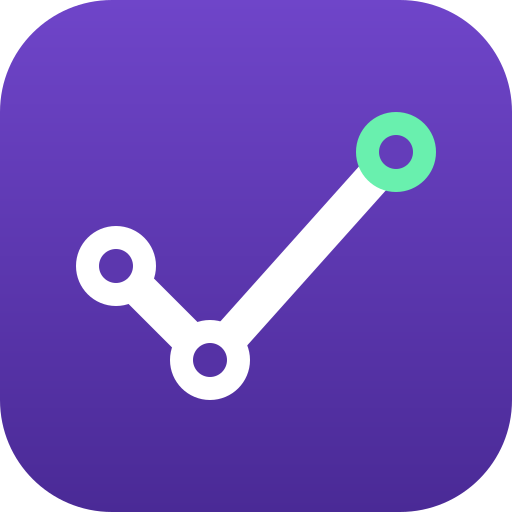
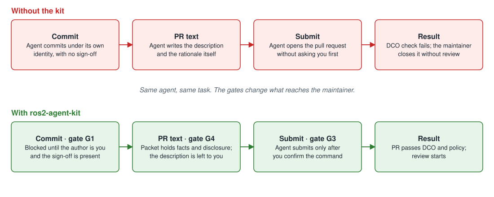
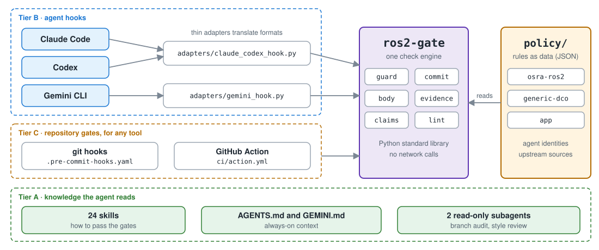
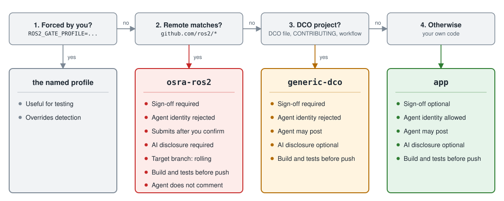
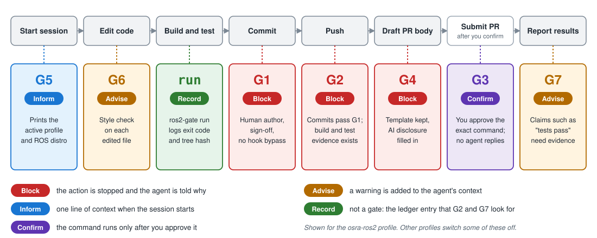
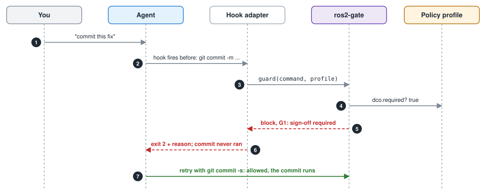
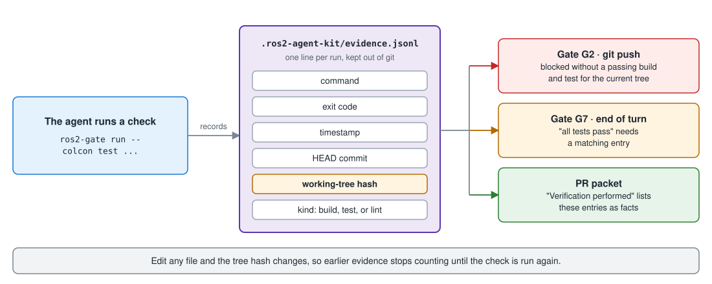
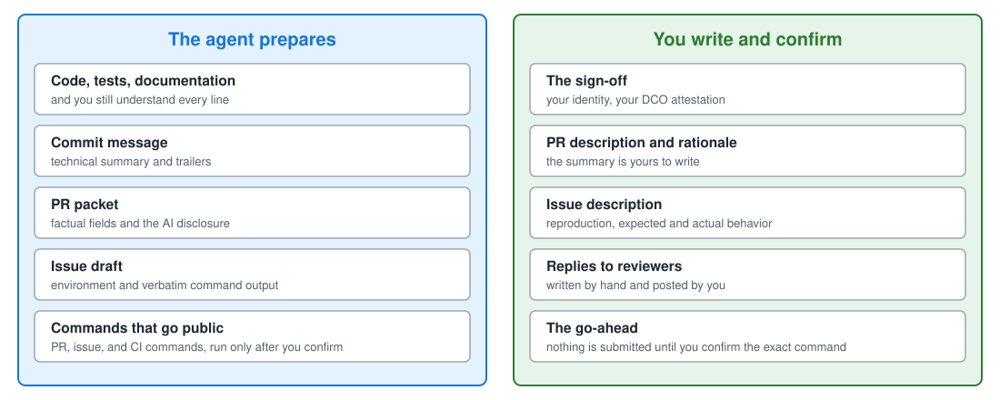
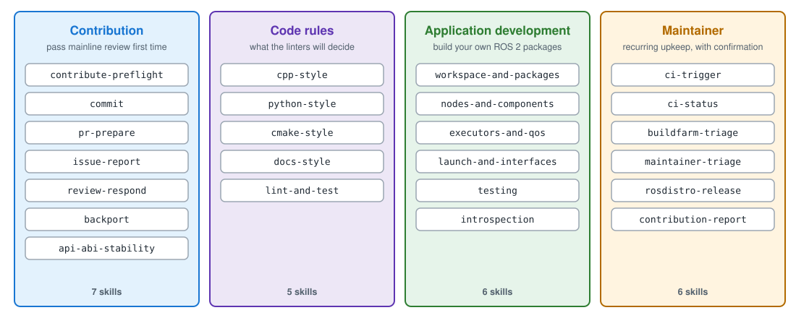

<!-- _class: lead -->
<!-- _paginate: false -->



# ros2-agent-kit

### Agent skills, hooks, and checks for ROS 2 development and mainline contribution for Claude Code, Codex, and Gemini CLI.

<!--
These slides use the Marp format.
Open them with the "Marp for VS Code" extension, or export with: npx @marp-team/marp-cli overview.md --pdf --allow-local-files
-->

---

## Why this exists

- **Common, consistent skills:** one shared set of agent skills helps developers and users make ROS 2 better.
- **Maintained by people who know the core:** scattered skill packs are not well maintained, so these skills are kept by a maintainer of the ROS 2 core.
- **No reinventing the wheel:** nobody has to write the same ROS 2 skills and rules again and again.
- **AI guidelines built in:** the ROS guidelines for AI-assisted contributions are implemented in the skills and plugins.
- **More useful tools:** developers and maintainers get more tools for their everyday ROS 2 work.

---

## What changes with the kit



---

## What it gives you

| You are | You get |
| --- | --- |
| Application developer | Packages, nodes, launch files, and tests scaffolded to ROS conventions, with linters and tests run |
| First-time contributor | Preflight on the issue, the style rules, a correct sign-off, and a PR packet ready for you to finish |
| Regular contributor | Rolling-first flow, ABI checks, the backport title format, and a ready-to-run CI command for a maintainer |
| Maintainer | Read-only triage help, and CI jobs on ci.ros2.org with detected packages, run after you confirm |
| Contributor on any other tool | The same commit rules through git hooks and a GitHub Action |

Under the ROS 2 profile the agent submits a pull request or an issue only after you confirm it, never posts a reply for you, and is flagged when it reports a result it did not run.

---

## Design principles

- **Checks over prose:** if a program can check a rule, it is a gate, and skills explain how to pass it.
- **The human owns the words:** the agent writes code, tests, and documentation, not PR descriptions, issue text, or replies.
- **No claim without evidence:** the agent may only report a build, lint, or test result that ran on the current tree.
- **Upstream is the source of truth:** the kit reads the target repository's own templates and contribution files at run time.
- **Linters are the oracle:** `ament_lint` and the tests decide what is correct, and skills hold only what agents get wrong.
- **One core, thin adapters:** all logic is harness-neutral, and per-harness files only translate formats.

---

## Architecture: one check engine, three ways in



---

## Three tiers, because each one can be bypassed

| Tier | Mechanism | Depends on the harness | Can the contributor bypass it |
| --- | --- | --- | --- |
| A. Knowledge | Skills, plus `AGENTS.md` and `GEMINI.md` context | No | Yes, it is advice |
| B. Agent gates | Harness hooks calling `ros2-gate` | Yes | Yes, by disabling hooks |
| C. Repository gates | `pre-commit` git hooks and a GitHub Action calling `ros2-gate` | No | Local git hooks yes, the CI action no |

Tiers B and C call the same engine and read the same profile, so each rule is written once.

---

## Policy profiles: rules as data



A profile is one JSON file in `policy/profiles/`, and the first match wins.

---

## Gates along a contribution



---

## Inside one gate: a blocked commit



The gate fails open: if the kit itself breaks, the command is allowed and a note is printed.

---

## No claim without evidence



---

## The human owns the words



---

## 24 skills in four groups



---

## Without an agent: git hooks and CI

```yaml
# .github/workflows/ros2-gate.yml in the target repository
steps:
  - uses: actions/checkout@v4
    with:
      fetch-depth: 0
  - uses: fujitatomoya/ros2-agent-kit/ci@main
    with:
      profile: osra-ros2
```

```yaml
# .pre-commit-config.yaml
- repo: https://github.com/fujitatomoya/ros2-agent-kit
  rev: main
  hooks:
    - id: ros2-gate-commit-msg
    - id: ros2-gate-pre-push
```

---

## Install

```text
# Claude Code
/plugin marketplace add fujitatomoya/ros2-agent-kit
/plugin install ros2@ros2-agent-kit
```

```bash
# Codex
codex plugin marketplace add fujitatomoya/ros2-agent-kit

# Gemini CLI, from the generated branch
gemini extensions install https://github.com/fujitatomoya/ros2-agent-kit --ref gemini
```

Requirements: `git`, and `python3` 3.10 or newer.
The gate engine has no third-party dependencies and makes no network calls.

---

## Try it in two minutes

```bash
python3 gate/ros2-gate profile        # which rules apply here, and why
python3 gate/ros2-gate doctor         # prerequisites and setup hints
python3 gate/ros2-gate --profile osra-ros2 guard -- gh pr create
```

The last command prints the verdict and the reason, wrapped here to fit:

```text
ask (G3): gh pr create goes out under the human's name, so profile osra-ros2
requires the human to confirm the exact command first; by confirming, the human
states that they wrote the description, understand every change, and verified it
```

---

## How it stays correct

| Mechanism | What it catches |
| --- | --- |
| `source-watch` workflow, weekly | An upstream policy document changed; it opens an issue, and the target is to reflect the change within 14 days |
| `distro-matrix` workflow | A skill instruction or the gate breaks on Humble, Jazzy, Kilted, Lyrical, or Rolling |
| Skill trigger evals | A skill that no longer loads for its prompt, or that fires on an unrelated request |
| Gate unit tests | Regressions in the checks, on the Python of every supported distribution |
| Dogfooding | The kit's own pull requests must pass `ros2-gate check-range` |

---

## Summary

- The kit teaches an agent the ROS 2 rules through skills, and enforces the checkable ones through gates.
- One engine, `ros2-gate`, serves agent hooks, git hooks, and CI, and reads its rules from JSON profiles.
- You keep the parts that are yours: the sign-off, the words, and the final say on every submission.

Read more:

- [README](../README.md) for the parts list and commands.
- [Design document](../design/ros2-agent-kit-design.md) for the rationale, the roadmap, and the sources of every rule.
- [Policy profiles](../policy/profiles/) for the rules themselves.
